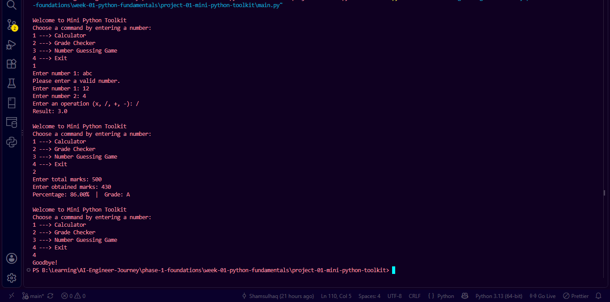

# Mini Python Toolkit

A menu-driven command-line program in Python with a simple calculator, a grade checker and a number-guessing game.

**Status:** Complete | **Completed:** 2026-11-15 | **Level:** Beginner

## Features
- **Calculator:** add, subtract, multiply (`x`) or divide two whole numbers, with a divide-by-zero check.
- **Grade checker:** enter total and obtained marks to get a percentage and a grade. Impossible marks (negative, or more than the total) are rejected.
- **Number guessing game:** guess a secret number from 1 to 100 with higher/lower hints and an attempt counter.
- **Safe input:** every number prompt keeps asking until a valid whole number is typed, so typing letters does not crash the program.

| Percentage | Grade |
|------------|-------|
| 90 or more | A+ |
| 80 to below 90 | A |
| 70 to below 80 | B |
| 60 to below 70 | C |
| 50 to below 60 | D |
| Below 50 | F |

## Tech
Python 3.6 or newer (standard library only; uses `random`).

## Setup and run
1. Install [Python 3](https://www.python.org/downloads/).
2. Clone the repository and open this folder:
   ```bash
   git clone https://github.com/shamsulhaqcodes/AI-Engineer-Journey.git
   cd AI-Engineer-Journey/phase-1-foundations/week-01-python-fundamentals/project-01-mini-python-toolkit
   ```
3. Run the program:
   ```bash
   python main.py
   ```

## Example
```text
Welcome to Mini Python Toolkit
Choose a command by entering a number:
1 ---> Calculator
2 ---> Grade Checker
3 ---> Number Guessing Game
4 ---> Exit
1
Enter number 1: 12
Enter number 2: 4
Enter an operation (x, /, +, -): /
Result: 3.0
```

## Demo


## What I learned
- Splitting a program into small functions (`get_int`, `calc`, `grade_checker`, `guessing_game`) keeps each part simple, and `get_int` is reused by all three tools.
- Wrapping `int(input())` in `try/except` inside a loop handles bad input without crashing.
- Returning `None` to signal "this failed" lets the menu decide whether there is a result to print.

## Limitations and next steps
- The calculator and grade checker accept whole numbers only (no decimals such as 7.5).
- The calculator does one operation per run, and multiplication uses `x` instead of `*`.
- The guessing game has no attempt limit and no way to quit before guessing correctly.
- Pressing Ctrl+C at a prompt stops the program with an error message instead of exiting cleanly.
- The menu starts as soon as the file runs. Putting it inside a `main()` function with an `if __name__ == "__main__":` guard would make the functions importable and testable.
- Next step: add automated tests with pytest (planned for Week 3).